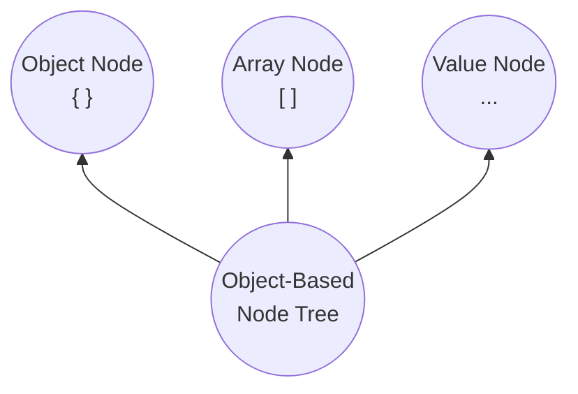

# SJF4J — Simple JSON Facade for Java


[](https://central.sonatype.com/search?q=sjf4j)
[](https://javadoc.io/doc/org.sjf4j/sjf4j)
  


    

[](https://codecov.io/gh/sjf4j-projects/sjf4j)


SJF4J is foremost **a simple JSON facade for Java**, 
evolving into **a unified structural processing layer built on JSON semantics**.

It brings JSON semantics directly to Java objects, combining unified structural processing, 
multiple serialization backends, and compile-time code generation.

## Quickstart

**Add SJF4J to your project (JDK 8+):**
```gradle
implementation("org.sjf4j:sjf4j:{version}")
```


**Define your Java objects:**
```java
public class User {
    public String name;
    public int age;
    public Address address;
}

public class Address {
    public String city;
}
```

**Bind, navigate, modify, patch, validate, and transform them:**
```java
Sjf4j sjf4j = new Sjf4j();

// Bind JSON to a POJO
User user = sjf4j.fromJson(json, User.class);

// Navigate and modify using JSONPath
JsonPath.parse("$.address.city").put(user, "Shanghai");

// Apply JSON Patch
JsonPatch.fromJson(patchJson).apply(user);

// Validate with JSON Schema
JsonSchema.fromJson(schemaJson).createPlan().validate(user);

// Transform to another POJO
AnotherUser another = sjf4j.fromNode(user, AnotherUser.class);

// Serialize to JSON
String output = sjf4j.toJsonString(another);
```

**Boost performance with compile-time code generation:**
```java
@CompiledBinder
interface UserBinder {
    @ReadFrom User read(String json) throws IOException;
    
    @WriteTo String write(User user) throws IOException;
}

UserBinder binder = CompiledInstances.create(UserBinder.class);
User user = binder.read(json);
```
Compile-time code generation also supports: `@CompiledNavigator` ( JSONPath navigation ), 
`@CompiledMapper` ( object mapping ), and `@CompiledJdbcMapper` ( JDBC `ResultSet` mapping ).


## Why SJF4J?

- **JSON Semantics, Native Java Objects**   
  Apply [JSONPath](https://www.rfc-editor.org/info/rfc9535/), [JSON Pointer](https://www.rfc-editor.org/info/rfc6901/), 
  [JSON Patch](https://www.rfc-editor.org/info/rfc6902/), and [JSON Schema](https://json-schema.org/) directly to POJOs, 
  Maps, Lists, and domain models — no intermediate JSON trees required.


- **Multiple Backends, One API**  
  Work seamlessly across JSON backends ([Jackson 2.x/3.x](https://github.com/FasterXML/jackson-databind), 
  [Gson](https://github.com/google/gson), [Fastjson2](https://github.com/alibaba/fastjson2), [JSON-P](https://github.com/jakartaee/jsonp-api)), YAML ([SnakeYAML](https://github.com/snakeyaml/snakeyaml)), 
  and Java Properties (Built-in) — all through a unified API.


- **Runtime Flexibility, Compiled Speed**  
  Enjoy flexible runtime APIs and highly optimized compile-time code generation.

Use SJF4J when you need more than serialization!

## Core Capabilities

SJF4J unifies essential structured-data capabilities under a consistent programming model:

```text
Modeling · Binding · Navigating · Patching · Validating · Mapping
```

### Modeling

SJF4J's **OBNT (Object-Based Node Tree)** enables flexible domain-oriented modeling — using strongly typed Java objects, 
dynamic structures, or a combination of both.

Rather than requiring a dedicated JSON tree representation, 
OBNT provides unified JSON semantics directly over native Java objects:
- **Object node**: POJOs, `Map`, `JsonObject`, JOJOs
- **Array node**: `List`, Java array, `JsonArray`, JAJOs
- **Value node**: `String`, `Number`, `Boolean`, Primitives, and custom value types



OBNT can be extended beyond regular POJOs and collections:
- Extend `JsonObject` to create a **JOJO (JSON-Object Java Object)**, combining typed properties with dynamic members in a hybrid object model.
- Extend `JsonArray` to create a **JAJO (JSON-Array Java Object)**, a typed, extensible array node.
- Use `@NodeValue` to model a Java type as a logical value node.
- Use `@OneOf` to model polymorphic node types.
- Register an `ExternalNode` to integrate your own structural types into OBNT.

Learn more → [Modeling (OBNT)](https://sjf4j.org/docs/modeling)


### Binding

SJF4J provides a unified runtime binding API for reading and writing Java objects across formats 
such as JSON, YAML, and Java Properties.
```java
Sjf4j sjf4j = new Sjf4j();

User user = sjf4j.fromJson(json, User.class);
String yaml = sjf4j.toYamlString(user);
```

Binding supports POJOs, Maps, Lists, primitives, generic types, and custom types registered in OBNT.  
Custom binders can integrate additional data formats into OBNT, 
allowing the same structural APIs to work across different formats.

Learn more → [Binding (Formats)](https://sjf4j.org/docs/binding)


### Navigating

Query and modify Java object graphs using [JSONPath (RFC 9535)](https://www.rfc-editor.org/info/rfc9535/) 
and [JSON Pointer (RFC 6901)](https://www.rfc-editor.org/info/rfc6901/).

```java
JsonPath.parse("/address/city").put(user, "Shanghai");

List<String> names = student.findByPath("$..friends[?@.scores.math >= 90].name");
// student is a JOJO
```

Beyond property access, SJF4J supports recursive descent, filtering, and structural mutations through `get`, 
`find`, `add`, `remove`, and `ensurePut` — all without converting Java objects into intermediate JSON trees.

Learn more → [Navigating (JSONPath)](https://sjf4j.org/docs/navigating)


### Patching

Apply [JSON Patch (RFC 6902)](https://www.rfc-editor.org/info/rfc6902/) 
and [JSON Merge Patch (RFC 7386)](https://www.rfc-editor.org/info/rfc7386/) directly to Java object graphs.
```java
JsonPatch patch = JsonPatch.fromJson("""
        [{"op": "replace", "path": "/name", "value": "Alice Zhang"}]""");

patch.apply(user);      // In-place update
user.getName();         // "Alice Zhang"
```

Patches support partial updates to POJOs, Maps, Lists, and other OBNT nodes.   
They can be applied in place or to a copy, making them useful for API updates, configuration changes, and state synchronization.

Learn more → [Patching (JSON Patch)](https://sjf4j.org/docs/patching)


### Validating

Validate Java object graphs against [JSON Schema](https://json-schema.org/),
with full support for Drafts `2020-12`, `2019-09`, and `7`.

```java
JsonSchema schema = JsonSchema.fromJson("""
{
  "type": "object",
  "properties": {
    "name": {"type": "string", "minLength": 1},
    "age": {"type": "integer", "minimum": 0}
  },
  "required": ["name"]
}
""");

SchemaPlan plan = schema.createPlan();
ValidationResult result = plan.validate(user);
```

Reusable validation plans support repeated validation, 
while Java object graphs can be validated directly after deserialization, 
without additional parsing or intermediate tree construction.

Bean Validation integration through `@ValidJsonSchema` allows JSON Schema rules to participate in existing Java validation workflows.

**Experimental**: JSON Schema can also be used to generate Java models 
through the online [Schema-to-Java Generator](https://sjf4j.org/generator).

Learn more → [Validating (JSON Schema)](https://sjf4j.org/docs/validating)


### Mapping

Runtime mapping through `Sjf4j.fromNode()` supports object-to-object conversion based only on properties with the same names and compatible types.

```java
AnotherUser another = sjf4j.fromNode(user, AnotherUser.class);
```

For complex transformations, `@CompiledMapper` supports property renaming, 
custom expressions, nested mapping, and object creation strategies.

Learn more → [Mapping (Object-to-object)](https://sjf4j.org/docs/mapping)


